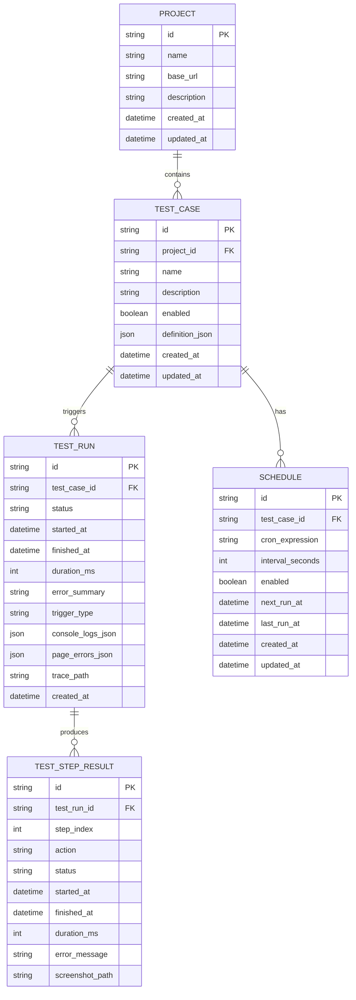
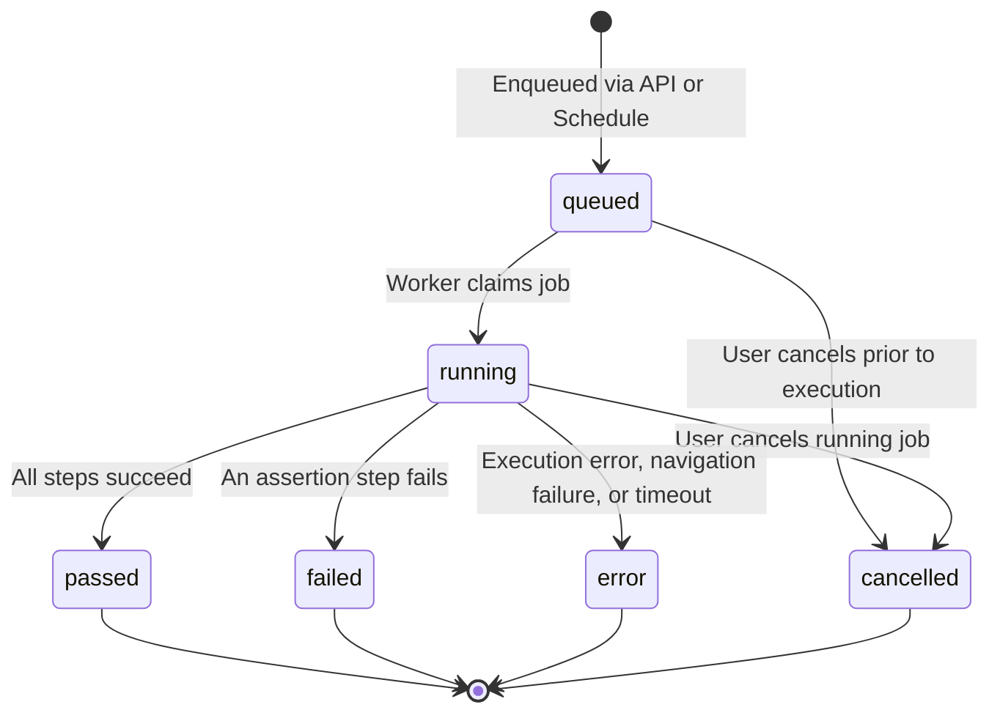

# Ghost-User Architecture Specification

## 1. Overview & System Mission

Ghost-User is an autonomous, reliable website testing agent designed to simulate real user journeys using Playwright, verify web application states, capture step-by-step evidence (screenshots, console logs, network errors, Playwright traces), and report actionable diagnostics for broken user flows.

The system is architected as an isolated, asynchronous execution platform where HTTP API handling is strictly separated from browser execution processes.


---

## 2. Monorepo Organization

```
Ghost-User/
├── apps/
│   ├── api/                  # FastAPI REST API service
│   │   ├── app/
│   │   │   ├── api/v1/       # Versioned route endpoints
│   │   │   ├── core/         # Config, logging, security & SSRF guards
│   │   │   ├── db/           # SQLAlchemy models, sessions, base
│   │   │   ├── schemas/      # Pydantic request/response validation schemas
│   │   │   ├── services/     # Business logic & query services
│   │   │   └── main.py       # FastAPI application entrypoint
│   │   ├── alembic/          # Database migrations
│   │   ├── pyproject.toml    # API dependencies & metadata
│   │   └── requirements.txt
│   ├── worker/               # Asynchronous browser test runner
│   │   ├── runner/           # Playwright automation engine & action handlers
│   │   ├── scheduler/        # APScheduler recurring task runner
│   │   ├── worker.py         # Worker polling loop & lifecycle manager
│   │   └── pyproject.toml
│   └── web/                  # Next.js 14+ dark-mode dashboard
│       ├── src/
│       │   ├── app/          # App router pages (overview, projects, tests, runs, schedules, settings)
│       │   ├── components/   # UI components (timeline, step editor, status badges, metrics)
│       │   ├── lib/          # API client, types, utility helpers
│       │   └── styles/
│       ├── package.json
│       ├── tailwind.config.ts
│       └── tsconfig.json
├── packages/
│   └── shared/               # Shared schemas, action definitions, types
├── tests/
│   ├── fixtures/             # Deterministic local test HTTP server for verified testing
│   ├── api/                  # Backend REST API tests (pytest)
│   ├── worker/               # Execution engine & action tests (pytest)
│   └── e2e/                  # End-to-end integration tests
├── docs/                     # Documentation & operational runbooks
├── scripts/                  # Cross-platform automation scripts
├── .env.example
├── .gitignore
└── README.md
```

---

## 3. Data Model & State Transitions

### Relational Schema



### Run Lifecycle State Machine



---

## 4. Test Definition Format

Tests are represented as strictly typed JSON objects with validated action payloads:

Supported actions:
1. `goto`: `{ "action": "goto", "url": "/login" }`
2. `click`: `{ "action": "click", "selector": "button#submit" }`
3. `fill`: `{ "action": "fill", "selector": "input#email", "value": "test@example.com" }`
4. `select_option`: `{ "action": "select_option", "selector": "select#country", "value": "US" }`
5. `check`: `{ "action": "check", "selector": "input#terms" }`
6. `uncheck`: `{ "action": "uncheck", "selector": "input#newsletter" }`
7. `wait_for_visible`: `{ "action": "wait_for_visible", "selector": ".dashboard", "timeout_ms": 5000 }`
8. `assert_visible`: `{ "action": "assert_visible", "selector": "#welcome-banner" }`
9. `assert_text`: `{ "action": "assert_text", "selector": "h1", "expected_text": "Dashboard", "exact": false }`
10. `assert_url`: `{ "action": "assert_url", "expected_url": "/dashboard" }`
11. `screenshot`: `{ "action": "screenshot", "name": "dashboard-loaded" }`

---

## 5. Security & Isolation Architecture

1. **Browser Network Security & Route Interception**:
   - Playwright context route interception (`context.route("**/*")`) dynamically intercepts every outgoing request (top-level navigations, clicks, redirects, fetch/XHR, and subresource elements like ``).
   - Re-evaluates destination origins against the authorized project origin.
   - Enforces IP CIDR blocklists (both IPv4 and IPv6: RFC 1918, CGNAT `100.64.0.0/10`, benchmark `198.18.0.0/15`, `169.254.0.0/16`, loopback `127.0.0.0/8`, IPv6 ULA `fc00::/7`, IPv6 link-local `fe80::/10`, IPv6 loopback `::1/128`, and cloud metadata `169.254.169.254`).
   - Strict production mode guard: in `ENVIRONMENT=production`, `ALLOW_LOCAL_TARGETS` is strictly forbidden and rejected at startup/validation.
   - Honest SSRF boundary: Playwright route interception blocks navigation and subresource requests to disallowed origins and private/metadata IPs. However, total SSRF defense against sophisticated internal DNS rebinding on live targets requires network-level egress proxies in production cloud environments.
2. **Origin Confinement**: Clicks, script navigations, and redirects cannot jump outside the base URL's registered origin domain.
3. **No Arbitrary Code**: Test definitions are declarative JSON schemas. No arbitrary Python `eval()`, shell commands, or injected scripts are ever executed.
4. **Artifact Authorization & Path Traversal Protection**:
   - In MVP, the artifact endpoints are designed for trusted local environments with strict path traversal verification (`path.resolve()`, `is_relative_to()`).
   - For production public exposure, an authentication reverse proxy or token authorization dependency (`verify_artifact_authorization`) must be enabled.

---

## 6. Worker Claim Mechanics & Concurrency Model

1. **Atomic Conditional Status Claiming**:
   - Queue consumers claim queued test runs using an atomic conditional update:
     ```sql
     UPDATE test_runs
     SET status = 'running', started_at = :now
     WHERE id = :candidate_id AND status = 'queued';
     ```
   - The claim is committed to the database *before* browser initialization. If two workers attempt to claim the same queued job, only one transaction updates the row; the losing worker receives `rowcount == 0` and safely backs off.
2. **Crash & Exception Resilience**:
   - If an unhandled exception or browser startup crash occurs, the worker immediately updates the run status to `error`, preventing jobs from hanging indefinitely in `running`.
   - On worker reboot, `recover_interrupted_runs()` inspects any orphaned `running` jobs from prior crashes and marks them as errors.
3. **Database Concurrency Considerations**:
   - **SQLite MVP**: Operates with single active execution (`WORKER_CONCURRENCY=1`) per worker process. SQLite WAL mode supports concurrent readers but serializes writes with file-level locks.
   - **PostgreSQL Production**: Multi-worker horizontal scaling requires PostgreSQL row-level locks:
     ```sql
     SELECT id FROM test_runs
     WHERE status = 'queued'
     ORDER BY created_at ASC
     LIMIT 1
     FOR UPDATE SKIP LOCKED;
     ```
     This allows dozens of concurrent worker nodes to claim distinct jobs simultaneously without lock contention or duplicate execution.

---

## 7. Failure Diagnostics & Observability

When a test run executes:
- Each step is individually timed and recorded in `test_step_results`.
- Automatic screenshots are captured at designated checkpoint steps and upon failure.
- If a step fails, execution halts cleanly, status is updated, and if enabled, a Playwright trace archive (`.zip`) is recorded for granular debugging.
- Unhandled console errors (`console.error`) and browser runtime exceptions (`pageerror`) are collected and persisted as structured JSON in the run record.
- Distinct error categorization: **Assertion Failure** (UI state mismatch) vs **Execution Error** (locator timeout, network disconnect, crash).
