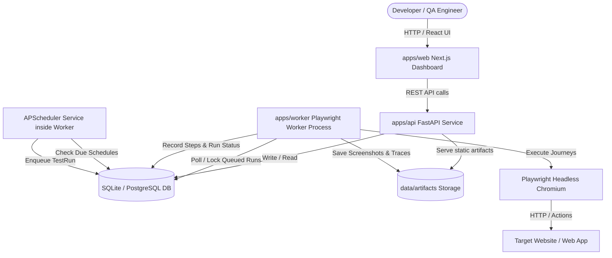
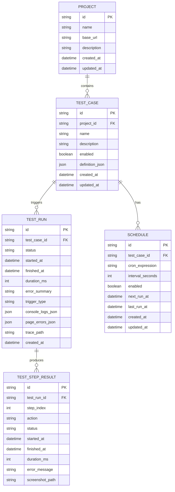
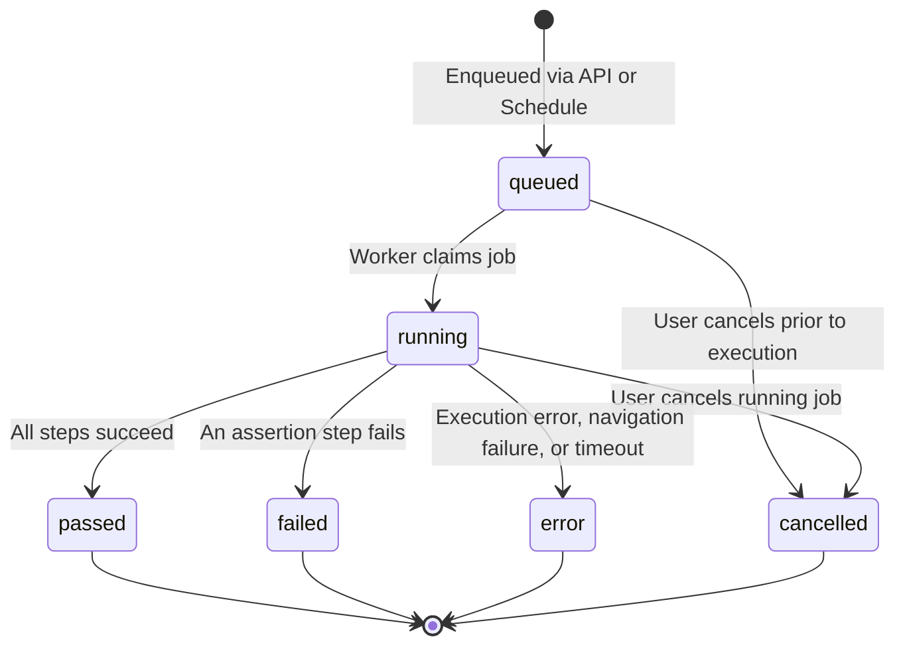

# Ghost-User Architecture Specification

## 1. Overview & System Mission

Ghost-User is an autonomous, reliable website testing agent designed to simulate real user journeys using Playwright, verify web application states, capture step-by-step evidence (screenshots, console logs, network errors, Playwright traces), and report actionable diagnostics for broken user flows.

The system is architected as an isolated, asynchronous execution platform where HTTP API handling is strictly separated from browser execution processes.



---

## 2. Monorepo Organization

```
Ghost-User/
├── apps/
│   ├── api/                  # FastAPI REST API service
│   │   ├── app/
│   │   │   ├── api/v1/       # Versioned route endpoints
│   │   │   ├── core/         # Config, logging, security & SSRF guards
│   │   │   ├── db/           # SQLAlchemy models, sessions, base
│   │   │   ├── schemas/      # Pydantic request/response validation schemas
│   │   │   ├── services/     # Business logic & query services
│   │   │   └── main.py       # FastAPI application entrypoint
│   │   ├── alembic/          # Database migrations
│   │   ├── pyproject.toml    # API dependencies & metadata
│   │   └── requirements.txt
│   ├── worker/               # Asynchronous browser test runner
│   │   ├── runner/           # Playwright automation engine & action handlers
│   │   ├── scheduler/        # APScheduler recurring task runner
│   │   ├── worker.py         # Worker polling loop & lifecycle manager
│   │   └── pyproject.toml
│   └── web/                  # Next.js 14+ dark-mode dashboard
│       ├── src/
│       │   ├── app/          # App router pages (overview, projects, tests, runs, schedules, settings)
│       │   ├── components/   # UI components (timeline, step editor, status badges, metrics)
│       │   ├── lib/          # API client, types, utility helpers
│       │   └── styles/
│       ├── package.json
│       ├── tailwind.config.ts
│       └── tsconfig.json
├── packages/
│   └── shared/               # Shared schemas, action definitions, types
├── tests/
│   ├── fixtures/             # Deterministic local test HTTP server for verified testing
│   ├── api/                  # Backend REST API tests (pytest)
│   ├── worker/               # Execution engine & action tests (pytest)
│   └── e2e/                  # End-to-end integration tests
├── docs/                     # Documentation & operational runbooks
├── scripts/                  # Cross-platform automation scripts
├── .env.example
├── .gitignore
└── README.md
```

---

## 3. Data Model & State Transitions

### Relational Schema



### Run Lifecycle State Machine



---

## 4. Test Definition Format

Tests are represented as strictly typed JSON objects with validated action payloads:

Supported actions:
1. `goto`: `{ "action": "goto", "url": "/login" }`
2. `click`: `{ "action": "click", "selector": "button#submit" }`
3. `fill`: `{ "action": "fill", "selector": "input#email", "value": "test@example.com" }`
4. `select_option`: `{ "action": "select_option", "selector": "select#country", "value": "US" }`
5. `check`: `{ "action": "check", "selector": "input#terms" }`
6. `uncheck`: `{ "action": "uncheck", "selector": "input#newsletter" }`
7. `wait_for_visible`: `{ "action": "wait_for_visible", "selector": ".dashboard", "timeout_ms": 5000 }`
8. `assert_visible`: `{ "action": "assert_visible", "selector": "#welcome-banner" }`
9. `assert_text`: `{ "action": "assert_text", "selector": "h1", "expected_text": "Dashboard", "exact": false }`
10. `assert_url`: `{ "action": "assert_url", "expected_url": "/dashboard" }`
11. `screenshot`: `{ "action": "screenshot", "name": "dashboard-loaded" }`

---

## 5. Security & Isolation Architecture

1. **SSRF Guard**: All target URLs must use `http` or `https`. Unless `ALLOW_LOCAL_TARGETS=true` is set (for local dev/testing fixtures), IP resolution blocks private RFC1918 ranges (10.0.0.0/8, 172.16.0.0/12, 192.168.0.0/16), loopback (127.0.0.1/8), link-local (169.254.0.0/16), and cloud metadata endpoints (169.254.169.254).
2. **Origin Restriction**: Actions may not navigate outside the base URL's registered origin domain without explicit configuration.
3. **No Arbitrary Code**: Test definitions are declarative JSON schemas. No arbitrary Python `eval()`, shell commands, or injected scripts are ever executed.
4. **Artifact Path Traversal Protection**: All artifacts (screenshots, traces) are referenced by relative subpaths and verified to resolve strictly within `ARTIFACT_STORAGE_DIR`.

---

## 6. Failure Diagnostics & Observability

When a test run executes:
- Each step is individually timed and recorded in `test_step_results`.
- Automatic screenshots are captured at designated checkpoint steps and upon failure.
- If a step fails, execution halts cleanly, status is updated, and if enabled, a Playwright trace archive (`.zip`) is recorded for granular debugging.
- Unhandled console errors (`console.error`) and browser runtime exceptions (`pageerror`) are collected and persisted as structured JSON in the run record.
- Distinct error categorization: **Assertion Failure** (UI state mismatch) vs **Execution Error** (locator timeout, network disconnect, crash).
